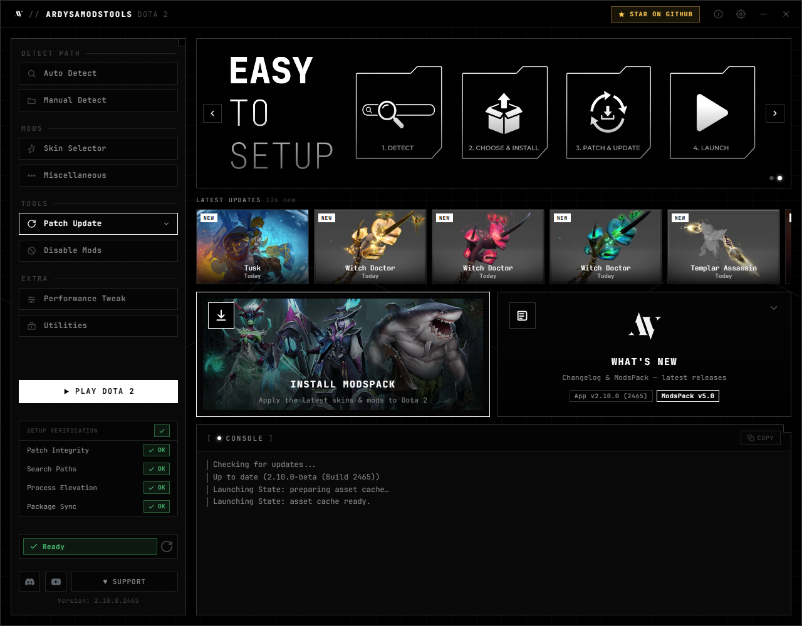
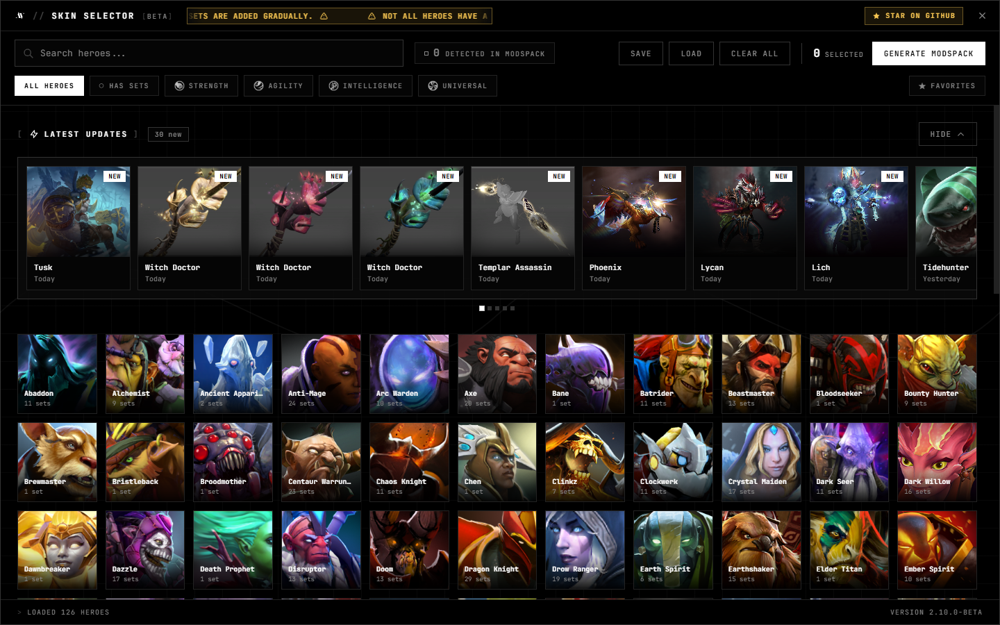
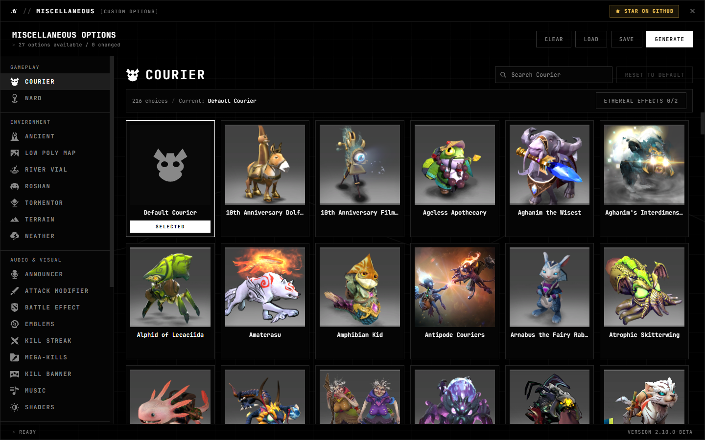
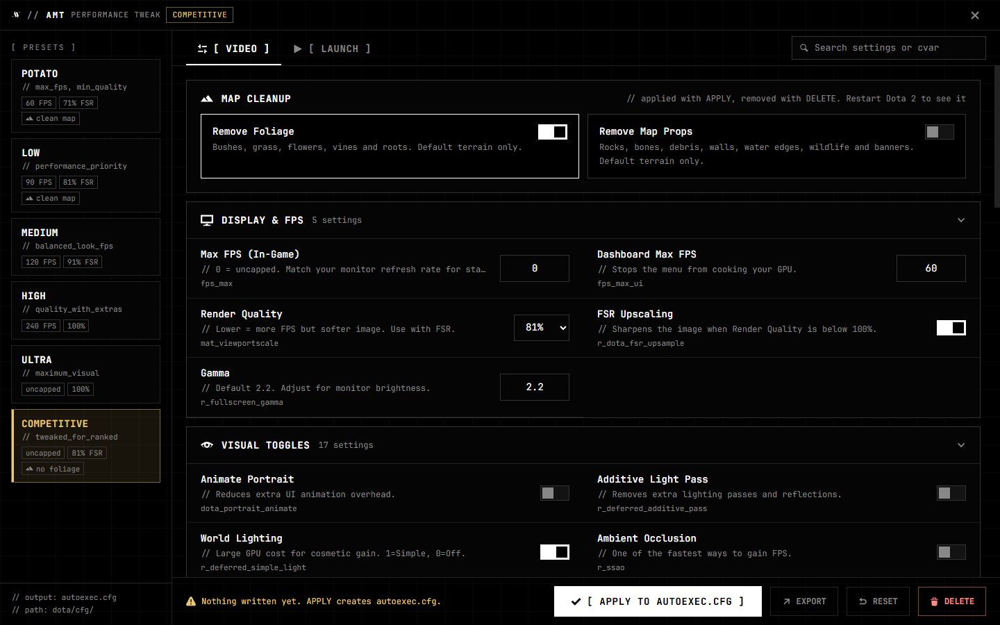
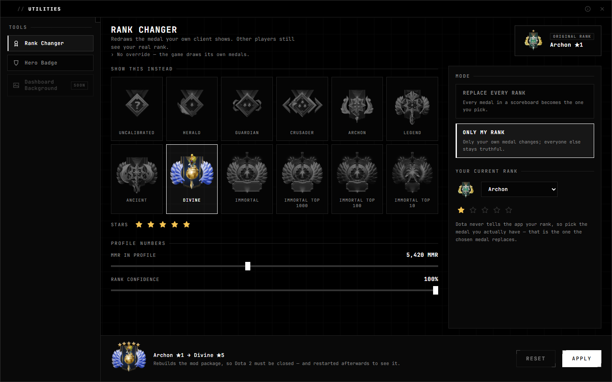

<picture>
  <source media="(prefers-color-scheme: dark)" srcset="docs/user/images/ardysa-mark-light.svg" />
  
</picture>

# ArdysaModsTools

**Cosmetic mod manager for Dota 2 on Windows.**
Install hero sets, terrains, HUDs, couriers and effects that only you can see, and switch back to the vanilla game whenever you want.

     

[Features](#features) · [Install](#install) · [Quick start](#quick-start) · [Safety](#safety) · [Docs](#documentation) · [Report a problem](#report-a-problem) · [Website](https://ardysamods.my.id)

  

> [!CAUTION]
> AMT is not affiliated with Valve or Steam. Mods are client-side: nobody else in the match sees them. Changing game files may break Valve's Terms of Service. Use at your own risk.

## Overview

ArdysaModsTools (AMT) is a Windows desktop app for client-side cosmetic mods in Dota 2. It downloads mod files, checks each one against its SHA-256 hash, writes them into their own folders inside your Dota 2 install, and patches the game config so Dota 2 loads them. Nothing is injected into the running game.

## Features

| Feature | What it does |
| :--- | :--- |
| **PLAY DOTA 2** | Starts the game through AMT. It waits out a pending Steam update, restores the game config if a Dota patch reset it, and rebuilds your mod package when the game's item data changed. Launching from Steam skips all of that. |
| **Install ModsPack** | Downloads and installs the curated mod pack in one step. |
| **Skin Selector** | Per hero, pick sets, single items, Arcanas, Personas, Prismatic overlays and Ability Effects, and add up to two particle effects. Then click **Generate ModsPack**. It marks what you already have installed, and your picks can be saved and loaded as presets. |
| **Miscellaneous** | Couriers and wards with ethereal effects, terrain, weather, HUDs, announcers, music, creeps, towers and more, in a searchable list. [Full list below.](#supported-mod-types) |
| **Performance Tweak** | Six presets from Potato to Competitive, every setting written to `autoexec.cfg`, FSR upscaling, Map Cleanup to remove foliage and map props, and launch options to copy into Steam. |
| **Utilities** | **Rank Changer** redraws the medal your own client shows; other players still see your real rank. **Hero Badge** swaps the hero level badge, its number and the level bar. |
| **Patch Update** | Rewrites the game config after a Dota 2 update. Its menu also has **Verify Mod Files** and **View Status Details**. |
| **Setup Verification** | Four checks in the main window: Patch Integrity, Search Paths, Process Elevation and Package Sync. |
| **Disable Mods** | Turns mods off and returns Dota 2 to vanilla, or deletes the mod files for good. |
| **Settings** | Dark or light theme, eight interface languages, a choice of download server with a connection test, and **Repair App** for WebView2 and app-folder problems. |

  
   <b>Skin Selector</b>

<table>
<tr>
<td></td>
<td></td>
</tr>
<tr>
<td align="center"><b>Miscellaneous</b></td>
<td align="center"><b>Performance Tweak</b></td>
</tr>
</table>

  
   <b>Utilities: Rank Changer</b>

### Supported mod types

| Group | Options |
| :--- | :--- |
| **Heroes** (Skin Selector) | Sets, single items, Arcanas, Personas, Prismatic overlays, Ability Effects, particle effects |
| **Gameplay** | Courier, Ward |
| **Environment** | Ancient, Low Poly Map, River Vial, Roshan, Tormentor, Terrain, Weather |
| **Audio & Visual** | Announcer, Attack Modifier, Battle Effect, Emblems, Kill Streak, Mega-Kills, Kill Banner, Music, Shaders |
| **Interface** | Cursor, HUD, Versus Screen |
| **Radiant and Dire units** | Creeps, siege units and towers for each side |

## Safety

AMT rewrites real game files, so every write path is built to fail without leaving Dota 2 broken.

- Every download is checked against its SHA-256 hash before it is used.
- Writes into the Dota 2 folder go through a transaction. Files are staged in a temp folder, verified, swapped in, and rolled back if any step fails.
- Downloads come from two servers, Cloudflare R2 and a Backblaze B2 mirror. If one fails, AMT moves to the other. The ModsPack, hero sets and app updates resume where they stopped.
- To load mods, AMT edits two Valve files: `gameinfo_branchspecific.gi` and `dota.signatures`. A Dota update overwrites them, and **Patch Update** or **PLAY DOTA 2** writes them again.
- **Disable Mods** returns the game to vanilla. Steam's *Verify integrity of game files* does the same.

## Install

**You need:** Windows 10 version 1809 or later (64-bit) or Windows 11, and Dota 2 installed through Steam. The installer adds the [Microsoft WebView2 Runtime](https://developer.microsoft.com/microsoft-edge/webview2/) if it is missing. AMT ships its own .NET runtime, so nothing else needs installing.

1. Download `ArdysaModsTools_Setup_<version>.exe` from [Releases](https://github.com/Anneardysa/ArdysaModsTools/releases) or [ardysamods.my.id](https://ardysamods.my.id).
2. Run the installer.
3. Start **ArdysaModsTools** from the desktop shortcut or the Start menu.

> [!TIP]
> Settings are kept in `%AppData%\ArdysaModsTools`, apart from the app, so they survive updates. The log file, `ardysa_fallback.log`, is in `%LocalAppData%\ArdysaModsTools`. Skin Selector and Miscellaneous presets are saved wherever you choose.

## Quick start

1. Close Dota 2 and open AMT. It finds your Dota 2 folder by itself. If it can't, click **Manual Detect** and pick the `dota 2 beta` folder.
2. Click **Install ModsPack** for the full pack, or open **Skin Selector**, pick what you want and click **Generate ModsPack**.
3. Start the game with **PLAY DOTA 2**. After a Dota 2 update this button repairs your mods before the game starts.

If mods stop loading after a Dota 2 update, click **Patch Update**. The [User Guide](docs/user/USER_GUIDE.md) covers every screen.

## How it's built

- C# on .NET 8, published self-contained for Windows x64.
- A WinForms host with WebView2 pages. The pages are written in React and TypeScript and built with Vite into the HTML files under `Assets/Html`. They talk to the app only through WebView2's message bridge.
- MVP layering: forms wire events, presenters hold UI logic, and services hold business logic behind interfaces, all connected through constructor injection.
- AMT never hooks or injects into the Dota 2 process. It only changes files on disk.

## Documentation

| Guide | |
| :--- | :--- |
| [User Guide](docs/user/USER_GUIDE.md) | Every feature, step by step |
| [Quick Start](docs/user/QUICK_START.md) | First install and first generate |
| [FAQ](docs/user/USER_GUIDE.md#faq) | Bans, safety, updates and other common questions |
| [Troubleshooting](docs/TROUBLESHOOTING.md) | Error codes and fixes |
| [Contributing](.github/CONTRIBUTING.md) | How to report bugs and request mods |
| [Security Policy](.github/SECURITY.md) | Reporting vulnerabilities |
| [Privacy Policy](PRIVACY.md) | What AMT sends and stores |
| [Code of Conduct](.github/CODE_OF_CONDUCT.md) | How we treat each other |
| [Changelog](CHANGELOG.md) | What changed in each release |

## Report a problem

Found a bug, want a hero set added, or spotted a bad translation? Open an issue with the matching template. It gets triaged from there.

| | |
| :--- | :--- |
| [Bug report](https://github.com/Anneardysa/ArdysaModsTools/issues/new?template=1-bug.yml) | Something is broken. Include the error code (for example `DL_006`) and attach `ardysa_fallback.log`. The **Open Log Folder** button on the failure card takes you to it. |
| [Mod / set request](https://github.com/Anneardysa/ArdysaModsTools/issues/new?template=2-mod-request.yml) | A hero set, courier, ward, HUD or terrain you want added |
| [Feature request](https://github.com/Anneardysa/ArdysaModsTools/issues/new?template=3-feature.yml) | An idea for how AMT itself should work |
| [Translation fix](https://github.com/Anneardysa/ArdysaModsTools/issues/new?template=4-translation.yml) | Wrong or awkward text in your language |
| [Discord](https://discord.gg/5xKg4fyumv) | "How do I…" questions and quick help |
| [Security advisory](https://github.com/Anneardysa/ArdysaModsTools/security/advisories/new) | Vulnerabilities, reported privately and never in a public issue |

**Two things before you file:** make sure you're on the latest release, and if Dota 2 updated recently, click **Patch Update** in AMT first. Those two fix most reports. Details are in [CONTRIBUTING.md](.github/CONTRIBUTING.md).

## Contributing

AMT does not accept code from outside the project. Pull requests are closed without being merged or applied, and the repository takes no outside collaborators. This GitHub repository is a one-way mirror of a private upstream.

Issues stay open to everyone. Bug reports, mod and set requests, feature ideas and translation fixes all help. See [CONTRIBUTING.md](.github/CONTRIBUTING.md).

## Project activity

## Credits

- **Ardysa** ([@Anneardysa](https://github.com/Anneardysa)), author and lead developer
- The Dota 2 modding community, and **Valve** for the game
- [Dota 2 Skinchanger](https://dota2changer.com)
- [Darkness](https://t.me/s/Darkness_Logovo)
- [Kisilev](https://vk.com/id363951132)
- [Source 2 Viewer](https://github.com/ValveResourceFormat/ValveResourceFormat)

## License and trademarks

Source code is licensed under the **GNU General Public License v3.0**. See [LICENSE](LICENSE).

The names **"ArdysaMods"**, **"ArdysaModsTools"** and **"AMT"**, the logo, the visual identity and the domains (`ardysamods.my.id`, `cdn.ardysamods.my.id`) are **excluded** from the license. Derivative work must use a distinct name, logo, and its own update and CDN endpoints. See [NOTICE](NOTICE).

---

**© 2025-2026 Ardysa.** Made for the Dota 2 community.

If AMT is useful to you, star the repo on GitHub.

